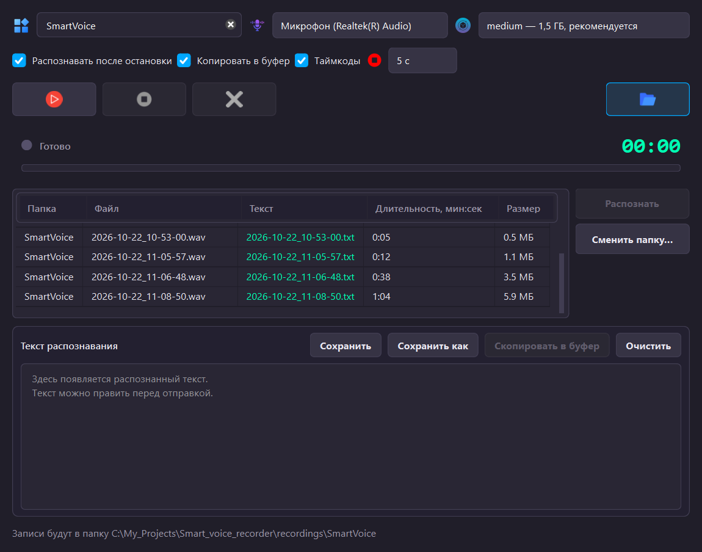

# Голосовые заметки

Запись голоса с микрофона и расшифровка в текст — локально, на своей машине.
Интернет для распознавания не нужен: модель скачивается один раз и дальше
берётся с диска.

Записи складываются в папки-блоки, расшифровки лежат рядом с ними обычными
`.txt`. Никакой базы, никакого закрытого формата: всё, что записано, можно
открыть и перенести куда угодно.



## Что умеет

- **Запись** с любого микрофона, с паузой и уровнем звука на лету
- **Распознавание** речи в текст моделью Whisper, без интернета
- **Автоматическая расшифровка** после остановки записи, с копированием
  результата в буфер обмена
- **Чистый текст на выходе**: метки времени и разделители можно убрать,
  чтобы текст годился для другой программы
- **Блоки** — каждая запись лежит в своей папке, в таблице видны только записи текущего блока
- **Правка текста** прямо в окне, с сохранением обратно в файлы
- **Открытие файлов двойным щелчком**: звук — в проигрывателе, текст — в блокноте

## Требования

- Windows
- Python 3.14
- [Poetry](https://python-poetry.org/)
- Около 2 ГБ свободного места под модель. В Windows без режима разработчика
  файлы модели дублируются, и нужно до 3 ГБ — приложение предупреждает об этом
  при первом запуске

Расшифровка идёт на процессоре, видеокарта не нужна. Модель `medium`
на короткой записи укладывается примерно в 2,5 раза длиннее её длительности:
запись в 40 секунд распознаётся около 16 секунд.

## Установка

```bash
poetry install
poetry run python main.py
```

При первом запуске приложение скачает модель — это 1,5 ГБ и несколько минут.
Перед загрузкой оно показывает уведомление: что скачивается, в какую папку,
каким способом хранятся файлы и что будет после. Дальше модель лежит в папке
приложения (`%LOCALAPPDATA%\SmartVoiceRecorder\models`), и интернет больше не
нужен: распознавание идёт локально.

Пока модель скачивается, строка состояния показывает проценты, скорость и
оценку остатка: `Скачиваю модель «medium»: 45% (640 МБ из 1,4 ГБ), 8,2 МБ/с,
осталось ~2 мин`. Когда файлы докачаны, модель грузится в память — этот этап
тоже занимает время, о нём сообщает счётчик секунд.

## Сборка в один файл

```bash
poetry run pyinstaller SmartVoiceRecorder.spec
```

Готовый файл — `dist\SmartVoiceRecorder.exe`, около 120 МБ. Python на целевой
машине не нужен.

Модель распознавания (1,5 ГБ) в сборку **не входит**: приложение скачивает её
само при первом запуске, как и обычную версию.

В спецификации вручную перечислены файлы, которые PyInstaller не находит сам:
модель фильтра тишины `faster_whisper/assets/silero_vad_v6.onnx` и иконки
`src/assets`. Без модели фильтра распознавание в собранном файле не работает,
хотя в запуске из исходников — работает. На этот случай в `transcriber.py`
есть запасной путь: если фильтр тишины не сработал, расшифровка повторяется
без него.

## Как пользоваться

1. Введите название блока в верхнее поле и нажмите Enter. Внизу появится
   полный путь, куда попадут записи.
2. Нажмите **▶** — пойдёт запись. Кнопка меняется на **❚❚** (пауза) и обратно.
3. **■** останавливает и сохраняет файл. **✕** отменяет последнюю запись —
   на диск ничего не попадёт.
4. **Распознать** берёт последнюю запись текущего блока без текста.
   Повторное нажатие прерывает распознавание: если прервали на середине,
   файла `.txt` не будет — запись можно распознать заново.
5. Расшифровку можно править в окне, **Сохранить** записывает правки в файлы.

Пока идёт распознавание, кнопка записи гаснет: одновременно писать и
распознавать нельзя, иначе пришлось бы молча прерывать распознавание.

Вторая зона с таблицей и текстом свёрнута и открывается только кнопкой
в правом верхнем углу. После распознавания она сама не открывается:
результат виден, когда нажмёте кнопку.

### Переключатели

Под верхней строкой настроек есть три переключателя. Все три включены
при первом запуске, дальше запоминается ваш выбор.

- **Распознавать после остановки** — после **■** запись сама уходит
  в расшифровку, нажимать **Распознать** не нужно. Если модель ещё грузится,
  распознавание дождётся её.
- **Копировать в буфер** — готовый текст сразу попадает в буфер обмена.
  Туда идёт **только что распознанная запись**, а не всё окно: так текст
  можно вставить сразу, не открывая вторую зону. Пустой текст в буфер
  не копируется, чтобы не затереть его содержимое.
- **Таймкоды** — добавлять ли в начало строк метки вида `[00:12]`.

С двумя включёнными сценарий сокращается до «записал → нажал ■ → вставил».

#### Таймкоды и чистый текст

Метки времени полезны, когда правят записи в окне: видно, где что
сказано. Но в готовом тексте, который уходит в буфер обмена или в чужую
программу, они только мешают. Поэтому с выключенными таймкодами в файле
`.txt` и в буфере остаётся **чистая речь** — без `[00:12]`, без дат и без
разделителей.

Разделитель между кусками виден в окне всегда: это серая полоска, а с
включёнными таймкодами — строка `── 13.10.2026 21:00 · идея ──`. В самом
тексте разделитель не занимает ни одного символа: граница лежит в
оформлении, а не в буквах. Поэтому её не видно ни в буфере обмена, ни в
файле — там остаётся только речь.

### Смена папки

**Сменить папку…** работает в двух случаях:

- выбрана папка блока внутри корня записей — приложение переходит в этот блок;
- выбрана папка снаружи — она становится новым корнем для записей.

Это сделано намеренно: раньше любую выбранную папку приложение делало корнем,
и папку блока можно было выбрать по ошибке. Тогда блоки начинали вкладываться
друг в друга (`recordings/идея/идея`).

## Где что лежит

```
recordings/                     ← корень записей
  линтер/                       ← папка блока
    2026-10-11_00-42-29.wav     ← запись
    2026-10-11_00-42-29.txt     ← расшифровка к ней
```

Настройки — отдельно от записей, в профиле пользователя:

```
%APPDATA%\SmartVoiceRecorder\settings.json
```

Путь не зависит от того, откуда запущено приложение: из ярлыка, из bat-файла,
из редактора — файл тот же.

Скачанная модель — в локальной папке приложения:

```
%LOCALAPPDATA%\SmartVoiceRecorder\models
```

Она не должна теряться при очистке кэшей, поэтому лежит не в кэше
Hugging Face, а в папке приложения. Если модель уже была скачана в старый
кэш, при первом запуске она переедет сюда сама.

## Настройки вручную

`settings.json` — обычный JSON, его можно править текстовым редактором:

```json
{
  "recordings_dir": "C:/путь/к/записям",
  "model": "medium",
  "microphone": 14,
  "last_block": "линтер",
  "auto_transcribe": true,
  "auto_copy": true,
  "timecodes": true
}
```

| Поле | Что значит |
|---|---|
| `recordings_dir` | Корень записей |
| `model` | `tiny`, `base`, `small` или `medium` |
| `microphone` | Номер устройства, `null` — выбрать автоматически |
| `last_block` | Название блока, подставленное в поле при запуске |
| `auto_transcribe` | Распознавать автоматически после остановки записи |
| `auto_copy` | Копировать распознанный текст в буфер обмена |
| `timecodes` | Добавлять метки времени `[00:12]` в начало строк |

## Разработка

```bash
poetry install
poetry run ruff check .
poetry run ruff check --fix .
```

Правила линтера закреплены в `pyproject.toml`, а не берутся из умолчаний ruff:
иначе вердикт менялся бы сам при обновлении инструмента.

Тесты (без Qt и железа, только чистая логика) — в `tests/`:

```bash
poetry run python -m unittest
```

Форматтер `ruff format` не применяется — код написан так, как есть.

Снимок в начале файла пересобирается из настоящего окна:

```bash
poetry run python make_screenshot.py
```

### Устройство проекта

| Файл | Что в нём |
|---|---|
| `main.py` | Точка входа |
| `storage.py` | Где лежат записи: поиск, длительность, порядок |
| `src/main_window.py` | Окно: кнопки, таблица, текст, статус |
| `src/recorder.py` | Запись звука, микрофоны, пауза |
| `src/transcriber.py` | Распознавание, отмена, разбивка на абзацы |
| `src/model_store.py` | Модель: скачивание, хранение в папке приложения, загрузка один раз |
| `src/widgets.py` | Индикатор записи и кнопка с переливом |
| `src/core/styles.py` | Всё оформление и цвета |
| `src/core/icons.py` | Загрузка значков |
| `src/config.py` | Настройки и пути в профиле пользователя |

Модули записи и распознавания ничего не знают про интерфейс и общаются через
колбэки — их можно вызывать из консоли и из тестов.

### Пара особенностей, о которых стоит знать

**Поток звука открывается в том потоке, откуда пришёл вызов.** WASAPI не
открывается из фонового потока и возвращает ошибку `-9999`. Поэтому
`Recorder.start()` зовёт из окна, а в своём потоке только ждёт и сохраняет.

**Частота записи 48 000 Гц, а не 44 100.** WASAPI отвергает 44 100.

**Запись не копится в памяти.** Звук не держится в оперативке всю запись:
как только буфер набрал полминуты, он дописывается в черновой файл рядом
с будущей записью. Поэтому хоть часовая, хоть ночная запись держит память
в районе десятков секунд звука и не имеет потолка по времени.

**Проценты распознавания не показываются.** Whisper молчит до конца первых
тридцати секунд звука, поэтому проценты прыгали с нуля сразу на семьдесят.
Вместо этого кнопка «Распознать» плавно переливается.

**Отмена распознавания ничего не пишет на диск.** Если прервали на середине,
файла `.txt` не будет. Так не появляется обрезанный текст.

**Первый запуск объясняет себя сам.** Пока модель скачивается, приложение
показывает, что именно грузится, в какую папку, каким способом хранятся
файлы и сколько места это займёт. После загрузки сообщает итоговый размер
и что интернет больше не нужен.

**Загрузка модели в память видна.** Пока модель читается с диска, внизу окна
висит сообщение об этом, и другие строки статуса его не перебивают (кроме
предупреждений и ошибок), пока модель не готова. Так понятно, чего ждёт
приложение после запуска.

**Модель лежит в папке приложения, а не в кэше.** Она не в общем кэше
Hugging Face, а в `%LOCALAPPDATA%\SmartVoiceRecorder\models`: кэш выглядит
одноразовым и его могут очистить, а модель должна переживать чистку и
переклоне проекта. Если модель уже была скачана в старый кэш, при первом
запуске она переедет в новое место сама — качать заново не придётся.

**Без симлинков модель занимает вдвое больше.** На Windows симлинки
доступны только в режиме разработчика. Если он выключен, Hugging Face
копирует файлы, и `medium` занимает около 3 ГБ вместо 1,5 ГБ. Уведомление
при первом запуске предупреждает об этом; вернуть место можно, включив режим
разработчика и удалив папку модели — она скачается заново, уже без копий.

**Служебные сообщения Hugging Face скрыты.** Строки про токен и симлинки,
которые библиотека печатала при загрузке, убраны из консоли. На случай
разбора проблем лог загрузки всё равно пишется рядом с настройками:
`%APPDATA%\SmartVoiceRecorder\model-load.log`.

## Лицензия

[GPL-3.0](LICENSE) — полный текст в файле `LICENSE`.

Выбрана не произвольно: приложение работает на **PyQt6**, а у неё лицензия
GPL-3.0. Если раздавать сборку под другой лицензией, условия PyQt6 будут
нарушены. GPL-3.0 — та, которая это требование выполняет.

Что это значит на практике:

- **Пользоваться самому** — свободно, никаких ограничений
- **Менять и распространять** — можно, но вместе с исходниками, тоже под GPL-3.0
- **Продавать сборку** — тоже можно, при условии, что исходники доступны
  покупателю

Модель Whisper в проект не входит: она скачивается отдельно и
распространяется на условиях MIT.